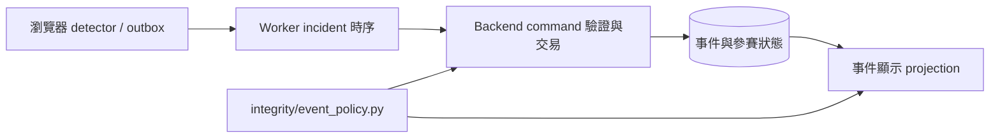

# 監考與違規流程：架構清理評估

## 範圍與基底

本輪沿 PR #413 的違規修正檢查 backend policy、command service、event projection 及 frontend runtime 組裝；不是整個 QJudge 的全庫重寫。基底為 `c492b5ed`，PR #413 尚未合併。原工作區的評分、申訴與題目編輯修改不在本輪範圍內。

## 結論

保留目前三層責任：瀏覽器收集觀測與暫存，worker 負責 incident 時序，backend 負責授權、設定生效與資料寫入。更乾淨的方向是讓純政策有明確歸屬，避免寫入流程依賴顯示模組；不需要再加通用規則引擎或 plugin framework。

## 已完成的保行為整理

1. **政策歸屬**：`registry_action_is_penalty` 從 `services/integrity_event_projection.py` 移到 `integrity/event_policy.py`。命令寫入與顯示各自引用純政策，不再由寫入服務引用顯示服務。
2. **單一 action 推導**：新增純函式 `default_registry_action`。省略 action 的預設值與顯式 action 驗證共用同一推導，允許的 action 為預設值或 audit，維持原本規則與錯誤碼。
3. **刪除死參數**：移除 `RecordIntegrityEvent` 和重送檢查中沒有讀取者的 `command_semantics`。建立 fingerprint 的本地 semantics 仍保留，重送驗證沒有降級。
4. **前端名稱與責任**：將沒有 hook 的 `useIntegrityRuntime.ts` 改為 `integrityRuntimePolicy.ts`；provider 私有配置型別移至 `IntegrityUploadProvider.tsx`，改名 `IntegrityCaptureOptions`。政策函式不再依賴 controller 型別。

本輪沒有變更 registry、grace period、違規門檻、暫停策略、API、資料庫 schema 或歷史紀錄。

## 後續整理順序

| 優先 | 目前證據 | 建議 | 完成條件 |
| --- | --- | --- | --- |
| 1 | `integrity_commands.py` 同時包含 resident 身分驗證、bootstrap、archive URL、command parsing、事件交易、checkpoint 更新；`exam_schedule.py` 只為取得 descriptor 也要引用它 | 下一個獨立變更先抽出 resident bootstrap／archive 能力，保留交易命令的既有入口 | bootstrap、finalize、internal command 測試通過；鎖定順序與冪等性維持 |
| 2 | `integrity_evidence.py` 同時處理 window 規劃、descriptor 驗證、資料庫狀態與 object storage | 將純 window 計算與儲存 I/O 分開；先建立固定輸入輸出案例再搬移 | retain/release 邊界、重送、terminal coverage、清除與跨來源測試通過 |
| 3 | commands、projection、evidence 都讀取 frozen registry，但對缺失資料的處理不同 | 可以共用底層 lookup；必須保留嚴格命令拒絕、保守顯示、證據相容查找三種明確語意 | malformed registry 與歷史事件的行為有契約測試，不以單一 fallback 吞掉差異 |

## 不建議現在做

- **把 backend 與 worker 強制合成共用 Python 套件**：兩者是獨立部署與信任邊界。先保持 JSON registry 契約與相容測試；少量 action 名稱重複不足以合理化部署耦合。
- **依檔案行數機械拆檔**：交易、鎖、receipt 與 idempotency 有共同不變條件，應以責任邊界拆，而不是每個函式一個檔案。
- **刪光 fallback**：延遲事件與平台中斷降級成 audit 是避免誤罰的政策；UI 缺失資料與寫入驗證不應使用相同錯誤策略。
- **把 frozen policy 全改為即時配置**：會改變歷史證據的解讀。老師關閉 webcam 的例外應留在命令生效邊界，原始事件與快照仍保留。

## 驗證

- 對重構前後 13 個 registry definition、3 個 phase、2 個延遲狀態、6 個 action 做等價比較：468 組驗證結果一致。
- 純政策與 registry：20 項測試通過。因 tests package 的初始化依賴 Django，host 驗證使用內容相同的暫存測試副本。
- Frontend runtime/session/provider：24 項既有測試通過。
- TypeScript、naming、architecture、repository exports 檢查通過；修改範圍 ESLint 為 0 errors、4 warnings。
- Docker daemon 未啟動，完整 backend/Django 與資料庫測試本輪未執行；合併前仍需 CI 驗證。
