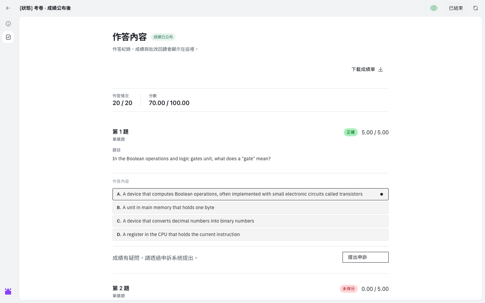
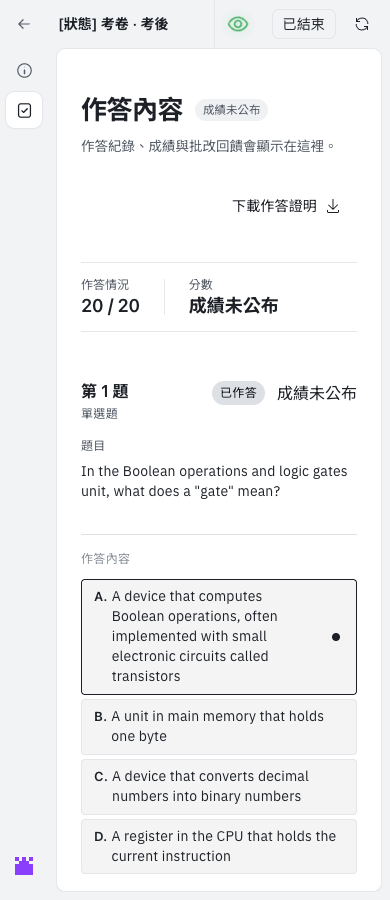
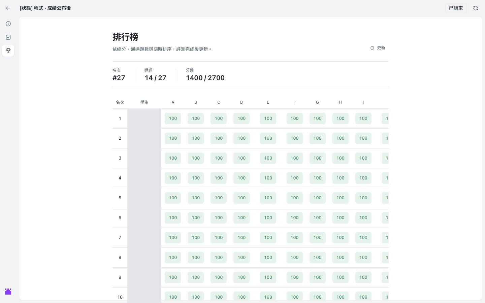
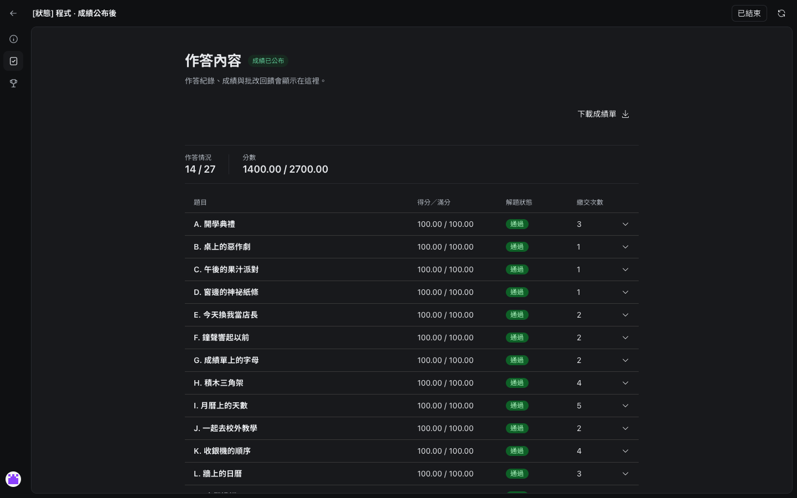
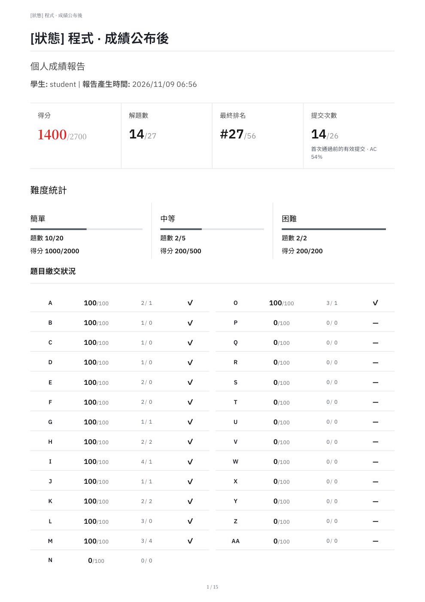
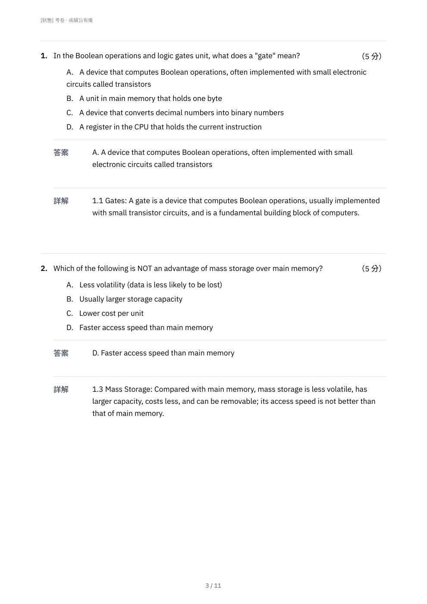

# Exam design alignment acceptance

Validated against origin/dev `9add20cb3` on 2026-11-09. The original checkout and existing development volumes were preserved. Screenshots are from the isolated feature checkout; other students' names are masked in the standings image.

- Frontend: `TZ=UTC npm test`, 316 files / 2027 tests pass. The first host-timezone run failed the existing date-format assertion; UTC matches its expected calendar date.
- `npm run typecheck`, `npm run build`, architecture and naming checks pass. Targeted ESLint: zero errors, one existing `tr` effect-dependency warning. Build retains the existing large-chunk warning. The i18n checker reports existing namespace gaps; the two new publication labels exist in all four locales.
- Backend (database-free, owning dev runtime): 16 tests pass across report score trends, document printing, literal paper answers and PDF conversion. The new teacher-sheet database test and the existing standings/export database suites are left to PR CI per the environment policy.
- Browser: real existing dev APIs; published/unpublished paper answers, proof download, coding records and standings on 1440px / 390px plus dark. No page errors or document horizontal overflow. The repository screenshot script additionally produced 30 state images; fixture schedules were not reseeded.
- Actual new Django download views return 200 `application/pdf` for published paper, unpublished proof and coding. Actual WeasyPrint output: six PDF types, 90 pages in total; no extracted words outside page bounds. Representative pages and contact sheets were visually inspected. A separate synthetic 180-line answer and feedback render spans 8 pages with both ending markers preserved.
- Independent whole-change review found two important issues (AC after allocation reduction, structured paragraph/literal-text loss). Both have failing-before / passing-after regressions. No newly introduced grading disclosure was found.

## Scope and decisions

Latest dev intentionally reserves reference answers/explanations for teachers. This change preserves that boundary rather than restoring the older Figma student explanation toggle. Student proof downloads, appeals, score policies and lazy submission history remain available.

Structured formula nodes preserve escaped LaTeX source in PDFs; browser KaTeX equation typesetting is not provided by the existing WeasyPrint renderer. No new formula service or dependency is introduced.

The existing Figma sample was corrected for publication/download wording, ended headers, partial scores/ranking, teacher-only explanation and fake verification codes. The broader Figma state-library expansion (all error/focus/mobile/dark specimens) is not represented as completed. A direct localhost import was blocked by automatic approval review because fixtures contained exam data; no such data was sent to Figma.

## Screenshots

