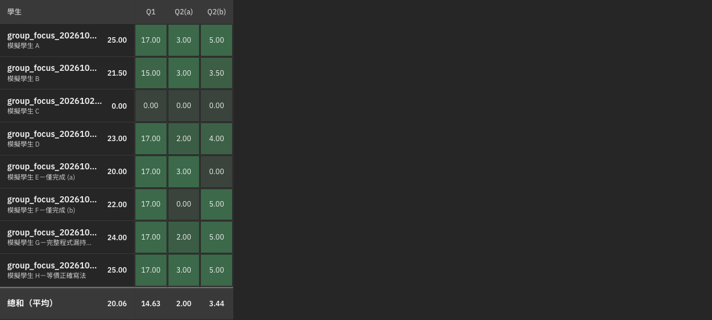

# Group-aware batch grading

Batch grading uses one unit per question group and keeps each child's score. A unit carries the complete grading prompts, all sibling question definitions, and each target student's original sibling answers. Already graded siblings are read-only context; other students' answers cannot be substituted.

One versioned rubric covers the unit. The version derives from question definitions and teacher instructions, not students or existing scores. The finalizer validates the complete unit's rubric and per-criterion results before writing any child scores. Missing or invalid results remain pending. Accepted rubrics are worker-owned and immutable; resuming uses the accepted version. Regrading a child includes its group while preserving manually changed scores.

The baseline SOP uses question and teacher requirements as the authority. It cannot establish the semantic correctness of an AI rubric or guarantee a particular score. Individual scoring disagreements belong to teacher review unless caused by the baseline instructions or a software/context defect.

## Validation

- Frontend behavior covers complete groups across batch boundaries, same-student sibling context, child-only retries, stable rubric versions, manual-score protection, and shared-rubric file viewing.
- AI tests cover complete-unit validation, missing child results, score arithmetic, source provenance, stale context/version, read-only answer IDs, and worker-owned rubric immutability.
- Private dev/staging fixtures use formal source questions and eight simulated students: correct, incorrect, partial, missing shared requirement, prohibited operation, and equivalent solution cases. They are not teacher-approved answer keys or point allocations.
- Formal exam text, student answer fixtures, and detailed screenshots remain outside this public repository. Public screenshots show the grading matrix only.

Live verification status and limitations are recorded in the PR and the existing Notion task. A completed AI run alone is not proof of saved grades.

## Dev verification

Eight simulated students completed 24 answer grades after retrying rejected draft structures. The original 24 answers remained unchanged; API scores matched the rendered matrix. The standalone question and the two-child group each have an accepted rubric, and criterion totals match the separate child scores. All-correct, incorrect, single-part, missing shared behavior, prohibited-operation and equivalent-solution cases were exercised; precise model point allocations are observations, not hardcoded acceptance assertions.

